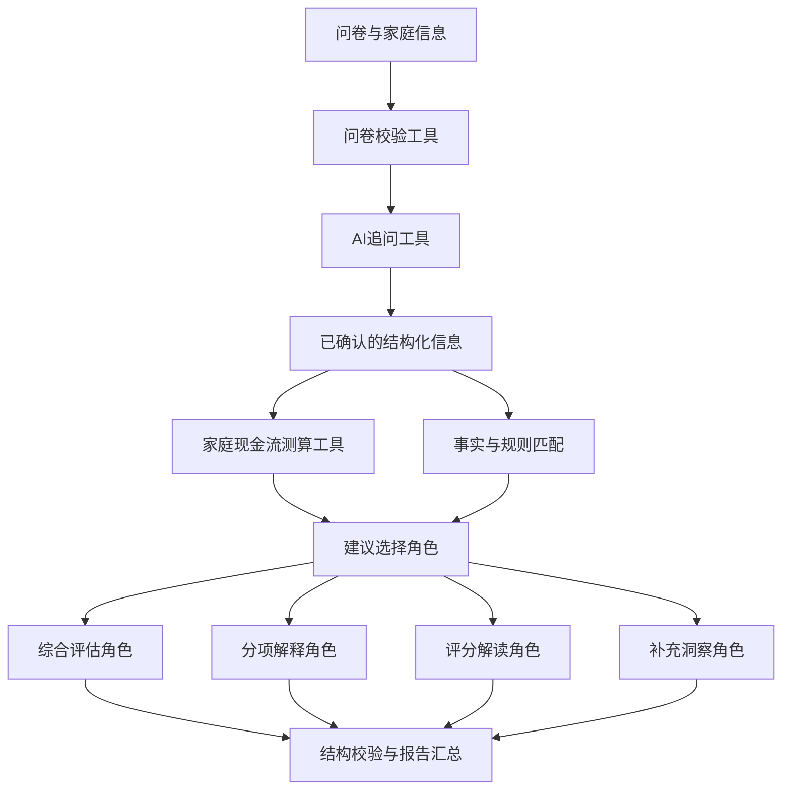

# 中国居民退休准备调研：AI评估核心

**让问卷产生可用的研究数据，也给参与者一份有依据的家庭退休准备评估。**

这个项目为长期开展的退休准备调研提供AI评估能力：根据家庭情况补充追问，检查填答中的遗漏与矛盾，独立计算家庭养老现金流，再由多个报告角色协作生成个性化解释与建议。

公开版本包含原平台的问卷、数学模型、追问规则和报告生成核心，提供独立Python入口与三个虚构家庭案例。我的工作重点是家庭现金流模型、三类工具以及评估报告的生成流程。

## 核心能力

| 工具 | 解决的问题 | 输出 |
|---|---|---|
| AI追问 | 固定问卷难以补全不同家庭的具体情况 | 有数量上限、可校验的补充问题与回答记录 |
| 问卷校验 | 错填、漏填和相互矛盾的答案会传入模型 | 需要补充或核对的字段，不擅自更改家庭事实 |
| 家庭现金流测算 | 夫妻退休时间、养老金、资产和支出难以统一计算 | 月度资产轨迹、四类情景覆盖指标与准备度评分 |

报告生成采用有明确分工的Multi-Agent流程。建议选择角色从符合事实的规则中挑选行动项；综合评估、分项解释、评分解读与补充洞察角色共享同一份已核验信息。金额与评分由Python计算，模型返回的结构及引用依据接受程序校验。



## 五分钟运行一个家庭案例

需要Python3.11或更新版本。在仓库目录执行：

```bash
python -m venv .venv
# Windows: .venv\Scripts\activate
# macOS / Linux: source .venv/bin/activate
python -m pip install -r requirements-dev.txt
python -m pip install -e . --no-deps
python -m retirement_readiness.cli examples/beijing.json --output output/beijing
python -m pytest
```

打开`output/beijing/report.html`即可阅读报告。`calculations.json`保存完整测算结果，`report.json`保存报告结构及事实依据。北京、昆明、唐山案例均为虚构家庭，不包含真实受访者数据。

默认使用离线规则生成报告，不调用外部模型，也不需要API密钥。此模式用于复现计算和检查流程。启用真实AI角色时，先在本地环境设置`LLM_API_KEY`、`LLM_MODEL`和兼容Chat Completions的`LLM_BASE_URL`，再执行：

```bash
python -m retirement_readiness.cli examples/beijing.json --llm --output output/beijing-ai
```

真实AI模式会把该案例的相关信息发送给你配置的模型服务。如果模型调用或结构校验失败，程序保存离线报告并明确标记运行模式，以退出码2提示；计算结果仍然保留。环境配置见[运行说明](docs/running.md)。

## 单独使用工具

```bash
# 检查问卷
python -m retirement_readiness.cli examples/kunming.json --validate-only

# 根据照护模块生成补充问题；添加--llm可启用模型
python -m retirement_readiness.cli examples/beijing.json --followup-module care

# 固定评估月份，避免随当前日期改变结果
python -m retirement_readiness.cli examples/tangshan.json --as-of 2026-09-01
```

## 数学模型与代码

模型逐月处理六类金融资产、工资与家庭支出，区分本人和配偶的退休安排，并处理有限养老账户耗尽。评估覆盖基本生活、常规医疗、重大疾病和失能照护四类情景。养老金、资产折扣和经济参数均保存在代码或数据文件中，可直接查看。

| 入口 | 内容 |
|---|---|
| `tools.py` | 三类工具的输入与输出边界 |
| `pipeline.py` | 计算、规则报告和AI报告的编排 |
| `core/household_cashflow.py` | 家庭月度积累与情景资源测算 |
| `core/pension_calculation.py` | 问卷信息对应的养老金预测 |
| `core/followup.py` | 动态追问、数量限制及失败回退 |
| `core/report_stages.py` | 各报告角色的调用与输出校验 |
| `tests/` | 金额保真、资金缺口、问卷冲突与失败处理 |

养老金和评分采用项目保存的研究参数快照；模型比较使用成员各自退休规划期及共同价格口径。详细假设见[模型说明](docs/model.md)。

维护者：[Yixuan Sun](https://github.com/Sunyx0825)。复现问题可以提交到Issues。
